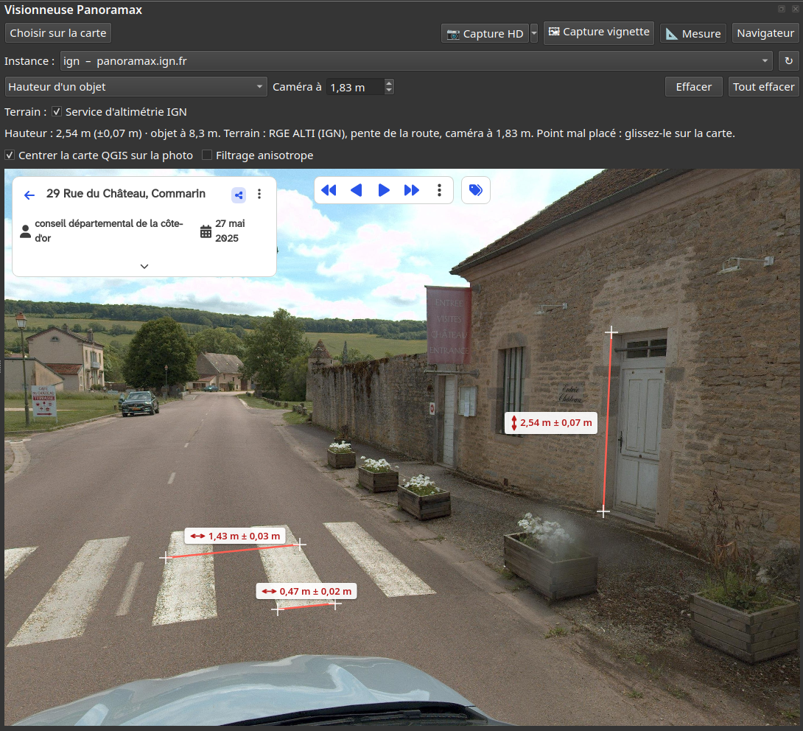
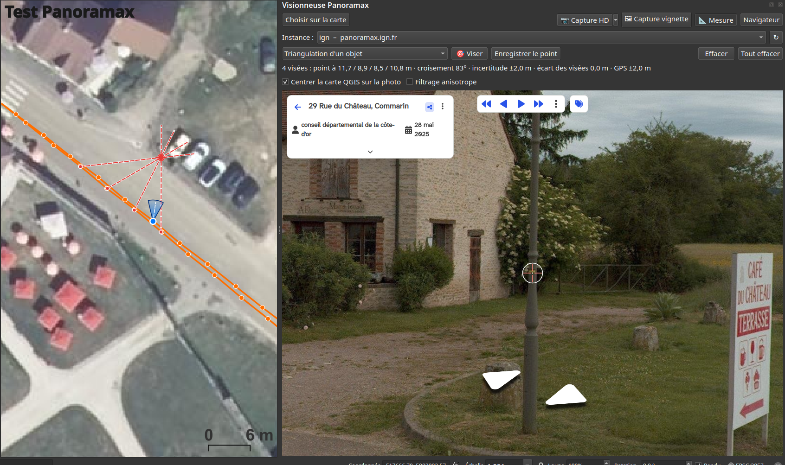

# Visionneuse Panoramax pour QGIS

[](https://github.com/medlab-code/visionneuse_panoramax/actions/workflows/tests.yml)

Plugin QGIS 4 qui intègre la visionneuse [Panoramax](https://panoramax.fr) avec des mesures à l'écran : largeurs, hauteurs, distances 3D et position d'objets par triangulation, directement dans la photo.

> **Prérequis : QGIS 4.0 ou plus récent.** L'extension ne fonctionne qu'avec QGIS 4 et les versions suivantes.

## Fonctionnalités

- Mesures (bouton « 📐 Mesure ») :
  - largeur perpendiculaire à la chaussée, longueur parallèle à la route et hauteur d'un objet, en deux clics dans la photo ;
  - triangulation d'un objet : le positionner (panneau, poteau, regard…) sur la carte en le visant depuis deux photos ou plus ;
  - recalage des points de mesure en les glissant sur la carte QGIS, puis nouvelle visée précise dans la photo, dans le plan ainsi calé ;
  - mesures affichées dans la visionneuse et sur la carte, conservées à l'écran jusqu'à « Tout effacer » ;
  - enregistrement des mesures et des points triangulés dans des couches QGIS, dans un fichier GeoPackage ou en couche temporaire ;
  - calage des photos : correction de l'inclinaison de la caméra, recalage du cap et de la position sur des repères de la carte, et hauteur de caméra déduite d'une longueur connue.
- Visionneuse Panoramax dans un panneau ancré, avec choix de l'instance.
- Mode compact du panneau : le chevron à droite de la barre réduit les boutons à leur icône et masque les lignes Instance, options et aide de la mesure (l'aide passe dans la bulle du bouton « 📐 Mesure »). Le choix est mémorisé.
- Filaire Panoramax (séquences et photos) en couche de tuiles vectorielles, semi-transparent à la création (opacité de 60 %) pour laisser voir le fond de carte ; l'opacité qu'on lui donne ensuite (*Propriétés › Symbologie › Rendu de la couche*) est mémorisée pour les filaires créés plus tard.
- Filtre des photos (bouton « Filtre ») : n'afficher dans le filaire, et n'ouvrir par un clic sur la carte, que les photos prises depuis une date, en 360° ou classiques, de précision GPS donnée (≤ 2 m pour le matériel de relevé, ≤ 4 m), ou d'un producteur (liste déroulante qui propose celui de la photo affichée). Le filtre est mémorisé ; « Filtre ● » signale qu'il est actif. Aux petites échelles (grille de densité), seul le type de caméra est filtré.
- Synchronisation carte ↔ visionneuse : curseur de vue (position, direction et ouverture) sur la carte, clic sur la carte pour ouvrir la photo la plus proche, carte QGIS recentrée sur la photo (option « Centrer la carte QGIS sur la photo »).
- Capture Full HD de la vue (« 📷 Capture HD »), recalculée à partir de la photo originale.
- Capture vignette (« 🖼 Capture vignette ») : la visionneuse telle qu'affichée, mesures comprises, enregistrée en PNG et copiée dans le presse-papiers.
- Option « Filtrage anisotrope » (décochée par défaut, mémorisée) : atténue le crénelage et le scintillement des détails fins vus de loin en gardant l'image nette, au prix d'une navigation un peu moins fluide.
- Sans QtWebEngine ou sans WebGL, une visionneuse native intégrée prend le relais, en **mode dégradé** (voir ci-dessous).

### Visionneuse intégrée (mode dégradé)

Si QtWebEngine n'est pas disponible dans votre installation de QGIS, ou si son moteur web ne prend pas en charge WebGL (pilote graphique), le plugin affiche les photos avec une visionneuse native de secours. C'est un **mode dégradé** : la photo est affichée en définition réduite, sans l'interface Panoramax (navigation par les boutons « ◀ Précédente », « Suivante ▶ » et « ⟲ 45° / 45° ⟳ » ; la visionneuse complète reste accessible par le bouton « Navigateur »), et **les fonctions de mesure peuvent ne pas fonctionner comme attendu** (visées moins précises, résultats à contrôler). Pour profiter de toutes les fonctions, utiliser une installation de QGIS qui fournit QtWebEngine avec WebGL.

## Mesures

Cliquer sur « 📐 Mesure » puis choisir le mode. Les méthodes de calcul, le recalage d'une mesure dans un plan défini sur la carte QGIS, les fonctions de calage, les sources d'erreur et des pistes d'amélioration (calculs et prise de vues) sont détaillées dans [docs/MESURES.md](docs/MESURES.md).



### Largeur et hauteur

- **Longueur parallèle à la route** : cliquer au sol aux deux extrémités de l'objet, typiquement le long de la route sur le côté du véhicule (façade, portail, place de stationnement…). La distance directe entre les deux points est mesurée ; elle reste juste dans n'importe quelle direction.
- **Largeur perpendiculaire à la chaussée** : cliquer au pied d'un bord (bordure, marquage, limite de chaussée), puis au pied du bord opposé. Les deux clics n'ont pas besoin d'être exactement en face : la largeur est prise perpendiculairement à l'axe de la route **à l'endroit mesuré** : tronçon de la BD TOPO de l'IGN qui traverse le milieu des deux bords (à un carrefour, la rue que traverse la mesure), sinon trajectoire de la séquence au plus près du point mesuré, sinon direction du véhicule à la caméra. Le résultat indique la source, par exemple « axe 47° (BD TOPO, D977BIS) » ; sur la carte, le trait bleu « perpendiculaire à la route » permet de la contrôler sur l'orthophoto. La distance en biais est aussi indiquée. À réserver aux mesures en travers de la route : le long de la route, la composante perpendiculaire est presque nulle.
- **Hauteur d'un objet** : cliquer au pied de l'objet (au sol), puis à son sommet, sur la même photo. Pour un bâtiment dont le pied est caché (voiture, haie), cocher **« Façade du cadastre »** : le mur est pris dans le cadastre, contrôlé par le LiDAR HD, et affiché sur la carte ; le pied peut alors être cliqué devant le mur (sur la voiture), il est ramené au bas de la façade, au sol.

Pendant la mesure, le curseur devient un réticule fin et un clic ne change plus de photo. Les points cliqués, le trait qui les relie et la valeur mesurée s'affichent directement dans la visionneuse (accrochés à la photo, ils suivent la vue), ainsi que dans le panneau et sur la carte. Une mesure terminée reste affichée quand on en commence une autre, quand on change de mode ou quand on arrête de mesurer : plusieurs mesures peuvent ainsi coexister à l'écran, chacune sur la photo où elle a été prise. « Effacer » supprime la mesure en cours, « Tout effacer » toutes les mesures affichées.

**Enregistrer les mesures** : le bouton « Enregistrer les mesures » ajoute les mesures terminées affichées à la couche « Panoramax – mesures ». Chaque mesure y est un segment (pour une largeur perpendiculaire, perpendiculaire à la route, à mi-chemin des deux bords cliqués ; pour une hauteur, un point, pied et sommet étant à la verticale l'un de l'autre), étiqueté de sa valeur, avec ses attributs : type et surface, valeur et incertitude, décomposition (horizontale, verticale, le long de la route, en travers), distance à la photo, hauteur de caméra (et si elle est calée), source du terrain, nombre de points recalés, identifiants des photos, date et un champ `commentaire` libre. Une mesure déjà enregistrée n'est pas ajoutée deux fois ; recalée ou visée à nouveau ensuite, elle est mise à jour au prochain enregistrement.

**Où sont enregistrées les couches** : au premier enregistrement, le plugin demande de choisir entre un **fichier GeoPackage**, conservé à la fermeture de QGIS, et une **couche temporaire**, perdue si on ne la sauvegarde pas avant. Le GeoPackage choisi est proposé à nouveau les fois suivantes ; mesures et points triangulés y sont deux tables (`mesures` et `points_triangules`). Choisir un GeoPackage qui contient déjà ces tables y ajoute les nouvelles entités.

**Recaler un point sur la carte** : pendant les mesures, les points des mesures (croix jaunes, comme dans la visionneuse) se **glissent sur la carte QGIS**. Si un point tombe mal (au-delà d'une façade, par exemple quand le pied cliqué n'était pas au contact du sol), le faire glisser à sa vraie place : sa position vient alors de la carte et son altitude du rayon de visée, et la mesure est recalculée, y compris une mesure terminée. Une hauteur dont le pied est recalé ne dépend plus ni du terrain ni de la hauteur de caméra. Glisser ailleurs déplace la carte, un simple clic ouvre la photo la plus proche.

**Viser à nouveau dans la visionneuse** : la carte, vue de haut, ne permet qu'un placement grossier ; elle fixe surtout le **plan** du point (sa distance à la caméra). Le **plan calé** est celui de la mesure : vertical, passant par les deux points glissés sur la carte (le mur), ou par le seul point glissé, face à la caméra. Pour placer un point avec précision, cliquer dans la visionneuse sur son repère (entre deux mesures) : un cercle jaune l'entoure. Le clic suivant, même tout près, le replace exactement à l'endroit visé, **dans le plan calé** (ou sur sa surface si la mesure n'a pas été calée). « Effacer » annule la sélection. On peut alterner librement : glisser sur la carte pour le plan, viser dans la photo pour la position fine. Pour une largeur le long d'un mur, glisser les deux points sur le mur, puis viser chacun. Chaque clic est prolongé jusqu'au sol (lancer de rayon), depuis une caméra placée à la hauteur indiquée (1,90 m par défaut, réglable : environ 2,2 m sur le toit d'une voiture, 1,7 à 2 m à pied ou à vélo).

Altitude du terrain : sources essayées dans l'ordre jusqu'à la première qui répond (délai de 5 secondes chacune) :

1. le service d'altimétrie de l'IGN : MNT du LiDAR HD (50 cm) là où il est publié, sinon RGE ALTI (1 m, France) ;
2. s'il ne répond pas ou ne couvre pas la zone : un service en ligne de secours, Open-Meteo Copernicus 90 m (monde). Sa maille est grossière : seule la pente générale de la rue est retenue (droite ajustée sur 180 m autour de la photo). Ce sont des modèles de surface, qui incluent les bâtiments : une pente supérieure à 12 % est jugée invraisemblable et la source est écartée ;
3. à défaut, un sol plat et horizontal.

Google Elevation n'est pas proposé : il exige une clé API et un compte de facturation, et ses conditions interdisent d'utiliser les données hors d'une carte Google.

La source utilisée, et la raison d'un éventuel repli, sont indiquées avec le résultat.

**Précision GPS vérifiée** : le plugin vérifie la précision des photos d'après leurs métadonnées (précision déclarée, ou correction différentielle contrôlée sur les photos voisines : altitude GPS moins sol LiDAR HD constante). Pour une position recalée par RTK, comme celles de l'imajbox, la hauteur de caméra est déduite de l'altitude GPS, convertie en altitude NGF par la grille du géoïde de l'IGN, à environ ±5 cm et sans calage ; le résultat indique « (altitude GPS) », et un bouton propose de reporter cette hauteur dans le champ « Caméra à ». **Inclinaison automatique** : les photos imajbox ne sont pas de niveau (1 à 3° avec le véhicule, soit environ 37 cm d'erreur par degré sur un point au sol à 6 m). Pendant la mesure, le plugin calcule l'inclinaison de chaque photo 360° d'après ses verticales (façades, poteaux), à ±0,1–0,2°, en téléchargeant la photo HD en arrière-plan ; en campagne, d'après la pente et le dévers du LiDAR HD sous le véhicule (±0,5°), sur une séquence où les verticales l'ont validé. La ligne d'état indique l'inclinaison retenue, ou l'avertit quand elle n'est pas calée. Détails dans [docs/MESURES.md](docs/MESURES.md#61-bis-inclinaison-automatique-par-photo). **Mode dégradé** : s'il manque la position vérifiée précise ou le LiDAR HD, une fenêtre l'annonce à l'activation de la mesure et invite à caler la hauteur de caméra et l'inclinaison ; une ligne d'état sous les boutons de mesure rappelle la précision de la position et la présence du LiDAR HD. Détails dans [docs/MESURES.md](docs/MESURES.md#27-précision-gps-vérifiée-et-mode-dégradé).

**Mesure sur un pont** : le modèle de terrain nu donne, sous un pont, le fond du cours d'eau. Pour une photo prise sur un pont, cocher « Mesure sur un pont » (ligne « Terrain ») : le sol est alors pris plat et horizontal sous la caméra, sans interroger les services. L'option n'est pas mémorisée d'une session à l'autre.

Là où le **LiDAR HD** est publié, le sol suit le **profil réel** de la chaussée le long de la visée (bordures, caniveau, dévers), lissé contre les points aberrants : le LiDAR décrit la chaussée à quelques centimètres près. Ailleurs (RGE ALTI, service de secours), le plugin retient la pente de la route autour de la photo (droite ajustée de façon robuste de 10 m derrière la photo à 25 m devant) : un modèle de terrain moins précis contient fossés, talus et bruit, qui fausseraient fortement les mesures éloignées. La fenêtre reste courte pour que la droite suive le sol de la rue près des points mesurés, et non le relief lointain. Les rues en pente sont ainsi prises en compte. L'inclinaison propre de la caméra (véhicule penché) se corrige par le calage (voir ci-dessous), et le MNT décrit le sol nu (ni voitures, ni murets). La précision baisse vite avec la distance : à réserver aux objets situés à moins de 15–20 m. L'incertitude affichée combine l'inclinaison de la photo (celle de son calage, ou 2° si elle n'est pas calée), la hauteur de caméra et la précision des clics : elle dit vraiment si une mesure est fiable (environ ±1,7 m sur une largeur de 7 m à 10 m d'une photo non calée, moins de ±0,3 m calée avec la hauteur par l'altitude GPS).

### Triangulation d'un objet

1. Mode « Triangulation d'un objet » : un réticule rouge apparaît au centre de la visionneuse.
2. Tourner la vue pour placer le réticule sur l'objet, puis « 🎯 Viser ».
3. Passer à une autre photo, idéalement décalée sur le côté de l'objet, et viser à nouveau le même objet.
4. Le point d'intersection s'affiche sur la carte avec l'angle de croisement, la précision GPS des photos et une incertitude estimée (erreur de visée de ±1°, ±0,5° pour le matériel de relevé, et précision GPS des photos). Une troisième visée améliore et contrôle le résultat. Chaque visée est pondérée : une visée lointaine ou une photo mal positionnée compte moins. Les erreurs communes aux photos d'une même séquence (décalage GPS, fixation de la caméra) ne se compensent pas : l'incertitude en tient compte.
5. « Enregistrer le point » l'ajoute à la couche « Panoramax – points triangulés », dans un fichier GeoPackage ou en couche temporaire (voir « Où sont enregistrées les couches » ci-dessus).

La précision dépend surtout de celle du GPS des photos (indiquée par Panoramax : 2 m pour le matériel de relevé, 4 à 5 m pour les caméras grand public et les téléphones ; 0,10 m retenu pour une position vérifiée recalée par RTK, comme celles de l'imajbox) et de l'angle entre les visées : visez de préférence avec un croisement d'au moins 30°. Quand l'EXIF de la photo donne le cap au centième de degré, il remplace le cap arrondi au degré de Panoramax.



### Calage des photos

Trois modes corrigent les défauts d'une photo avant de mesurer ; la correction s'applique ensuite à toutes les mesures (triangulation, largeur, hauteur) et est conservée dans le profil QGIS, d'une session et d'un projet à l'autre, jusqu'à ce qu'elle soit refaite ou effacée (le calage d'un projet enregistré par une version précédente est repris à son ouverture). Le calage en cours est rappelé sous les boutons de mesure, et « Effacer » le supprime.

- **Calage : inclinaison (objets verticaux)**, pour la photo affichée : cliquer le pied puis le sommet d'un objet bien vertical (poteau, angle de façade). Un objet corrige la pente vue dans sa direction ; un second objet, à environ 90° du premier, corrige toute l'inclinaison. C'est la principale source d'erreur des largeurs et des hauteurs. L'inclinaison est en général calculée automatiquement (voir plus haut) ; ce calage à la main l'emporte sur elle, pour une photo où la ligne d'état l'indique non calée ou pour contrôler.
- **Calage : cap et position (repères sur la carte)** : cliquer dans la photo un repère net, visible aussi sur la carte (poteau, angle de bâtiment), puis ce même repère sur la carte (glisser pour déplacer la carte, molette pour zoomer, Échap pour annuler). Les repères donnent, par relèvement, le décalage de cap et de position GPS de la séquence, chacun combiné à sa valeur d'origine selon les précisions : un repère seul corrige surtout le cap (le choisir lointain : à 100 m, 2 m d'erreur GPS faussent déjà le cap de plus de 1°) ; trois repères ou plus, bien répartis autour de la photo (devant, derrière, sur les côtés), recalent aussi sa position. Un repère incohérent avec les précédents est refusé. Le GPS dérivant au fil d'une séquence, le recalage ne vaut que pour les photos situées à moins de 300 m de celles qui l'ont servi ; la position recalée et sa précision remplacent alors celles du GPS dans les mesures.
- **Calage : hauteur de caméra (longueur connue)**, pour toute la séquence : choisir « au sol » ou « en hauteur » et indiquer la longueur réelle, puis cliquer ses deux extrémités au sol (place de stationnement, bande de passage piéton, trait de marquage, longueur mesurée sur l'orthophoto avec l'outil de mesure de QGIS) ou le pied puis le sommet d'un objet de hauteur connue. Les largeurs et les hauteurs étant à peu près proportionnelles à la hauteur de la caméra, le plugin en déduit celle-ci ; elle remplace la valeur saisie pour les mesures de la séquence, et elle est reportée et enregistrée dans le réglage « Caméra à » du panneau. Choisir une référence proche (moins de 10–15 m) et, au sol, plutôt en travers de la vue. Plusieurs références se combinent.

## Installation

Prérequis : **QGIS 4.0 ou plus récent**. L'extension ne fonctionne qu'avec QGIS 4 et les versions suivantes ; le gestionnaire d'extensions de QGIS refuse de l'installer sur une version antérieure.

### Depuis la release (recommandé)

1. Télécharger le fichier `visionneuse_panoramax-<version>.zip` de la [dernière release](https://github.com/medlab-code/visionneuse_panoramax/releases/latest) (toutes les versions : [releases](https://github.com/medlab-code/visionneuse_panoramax/releases)).
2. Dans QGIS : *Extensions › Installer/Gérer les extensions › Installer depuis un ZIP*, choisir le fichier téléchargé, puis « Installer l'extension ».

### Depuis les sources

Copier le dossier `visionneuse_panoramax` dans le répertoire des plugins de votre profil QGIS, par exemple :

- Linux : `~/.local/share/QGIS/QGIS4/profiles/default/python/plugins/`
- Windows : `%APPDATA%\QGIS\QGIS4\profiles\default\python\plugins\`

Activer ensuite le plugin dans *Extensions › Installer/Gérer les extensions*.

## Tests

Les calculs (triangulation, points 3D, mesures au sol, calage, profil du terrain, mesures et leur recalage sur la carte, filtre des photos) sont vérifiés par des tests automatiques sur des scènes synthétiques dont la réponse est connue. Ils ne demandent ni QGIS ni bibliothèque supplémentaire (QGIS, l'affichage et les services d'altitude y sont simulés) ; depuis le dossier du plugin :

```
python3 -m unittest discover -s tests
```

Ils sont lancés automatiquement sur GitHub à chaque push et pull request (Python 3.12 à 3.14), avec une analyse statique du code (pyflakes).

L'enregistrement dans les couches et le GeoPackage, ainsi que la conservation du calage, sont vérifiés par une seconde série, avec QGIS, à lancer sur son poste : `python3 -m unittest discover -s tests/qgis`.

Principe, contenu et ajout de tests : voir [tests/README.md](tests/README.md).

## Licence

GNU General Public License, version 2 ou ultérieure (voir [LICENSE](LICENSE)).

Cette licence ne couvre que le code du plugin. Les photos affichées restent sous la licence choisie par leur instance Panoramax (Licence Ouverte Etalab 2.0, CC-BY-SA…), qui impose de citer l'auteur et la source : les captures de vue portent cette attribution.

## Auteur

Cédric COCHART
